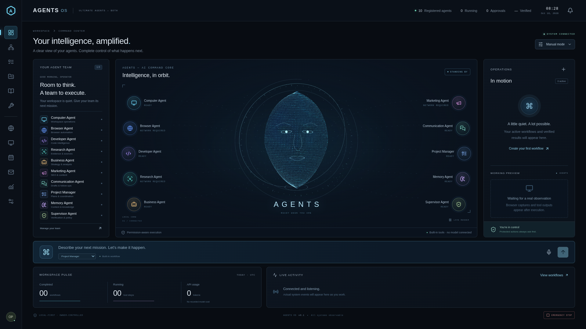
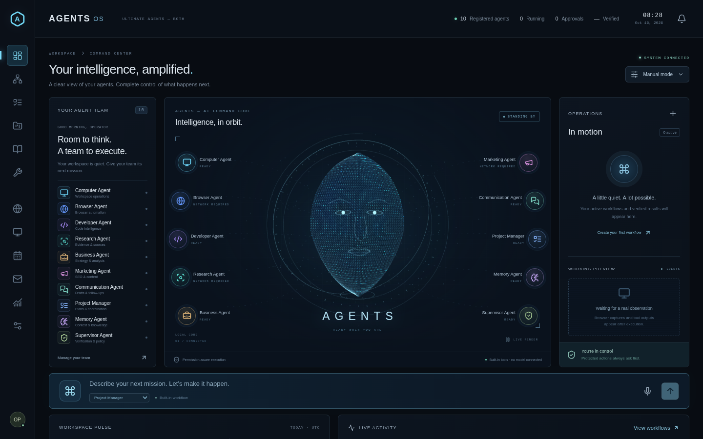

# Actual AGENTS dashboard captures

Captured from the running production application in Chromium on 16 October 2026, approximately 14:13 Nepal time. These are real browser captures, not mockups or generated images. No API calls or fabricated activity. Source commit: `a004c44684e4a21e522bcc065a15443c155c41a5`.

## Desktop — 1920 × 1080

## Laptop — 1440 × 900

The exact 900px viewport scrolls vertically. [Full laptop page](dashboard-laptop-full-page.png).

## Animation recording

[Download the actual H.264 MP4 recording](dashboard-animation.mp4?raw=true). If GitHub shows the file page, click **Download raw file**. Open the downloaded MP4 in your browser or Windows Media Player. Duration: 6.84 seconds; no audio. This is the actual Chromium screencast.

[Earlier mobile capture](dashboard-mobile.png), verified as a valid PNG. Mobile caption overlap remains a known visual issue.

This branch only adds preview media. No application deployment or source changes were made.
